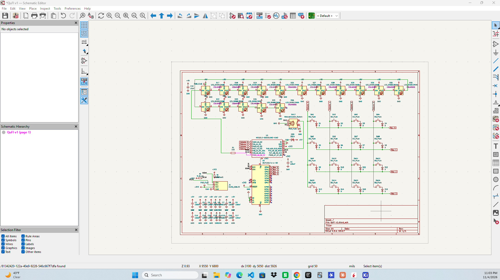

# November 1: Designed the Schematics layout

Worked on creating a matrix schematic for my macropad on Kicad and succesfuly created the schematic
and the connections.

**Total time spent: 2 hours**

# November 2: Designed the PCB layout

Worked on creating a PCB for my macropad on Kicad and added a rotary encoder components. A big time crunch today was making sure that my 
3dshapes paths were correct. This is my first time working on schematics and with the tutorial i'm watching of ScottoKeebs I ran into issues with pulling few 
3d models but after a few hours of troubleshooting I got it!

**Total time spent: 3 hours**

# November 3: Improve the schematics and added components

I realized yesterday(Nov 2) that I don't want to stick to just switches and rotary encoder. I want to add more features like led backlights to represent the 
command layer, or just for customization. I also wanted to add the oled display to display things features such as command layer, function choosen, or etc(the
full ideas for oled are still jogging through my mind for me to chase, lol). So I ended up watching a few videos, ton of google searches, and some questions for gemini
to figure out how voltage works for these additional components, expanding pins available, making sure the electrical properties are working correctly, 
and that the schematics is also simplified. In the end I added all my components and simplified the schematic to the best of my current ability. The components added 
include 16 mini e leds, I/O expansion, and a 128 by 32 pixel OLED display

**Total time spent: 2.5 hours**

# November 4: Simplify Schematics and Adjust NETS, POWER, and VOLTAGE

Bascially when I opened up my schematics today to check if everything is good for the get go on the PCB, I realized something. The schematics could be describe as modern "art",
so I committed myself to somewhat cleaning up this eyesore with the little I know about schematics so far and some help of gemini to figure out how to quickly apply changes onto multiple
components. In doing so ended up creating nets for most things, I also just simplified power connections with labels and pwoer flags. I also added a ton of capacitors to make sure the LED
colors were more consistant.

**Total time spent: 2 hours**

# November 5: Re-Arranging PCB

I honestly did not have any time today to do anything so I just went on for ten minutes and moved a few things around on the PCB and planned 
how I will move more stuff when I get the time.

**Total time spent: 0.16 hours**

# November 6: Continuation of PCB organization

I continued what I started the previous day which was the organization of all the components on the PCB before I get to routing. I mostly got everything completed except for capciotrs and resistors
which I will soon hopefully work on. I changed some footprints and layered some components on top of eachother. Lots of off camera research for me to undestand if its possible. Also I tried to make my own footprint 
which didn't go to well but I think I know how to do it if I need it in the future.

**Total time spent: 2.5 hours**

# November 7-8: More organization and routing traces

These two days I just pretty much did a tad bit of finalizing on where I wanted to place all the components on the board relative to routing and etc. I ended up routing mostly everything and had to watch a few videos on that.
I also had to learn how to make pour zones and other types of zones. I ended up doing a copper pour for my GND and just made a zone so that I don't have to individually trace it. I also did no pour zones so that some pads don't short 
circut the board. 

**Total time spent: 4.5 hours**

# November 9: Fixing everything on DRC and getting 3d model ready

Today I did the DRC and started debugging everything that had any conflcits. My main problems were some edge cuts and holes in my led footprints that I have no purpose for. So I ended up universally changing those footprints to a new edited
version I made. I also added some m2 screw holes around the board for me to properly screw it into the frame.

**Total time spent: 1.5 hours**
