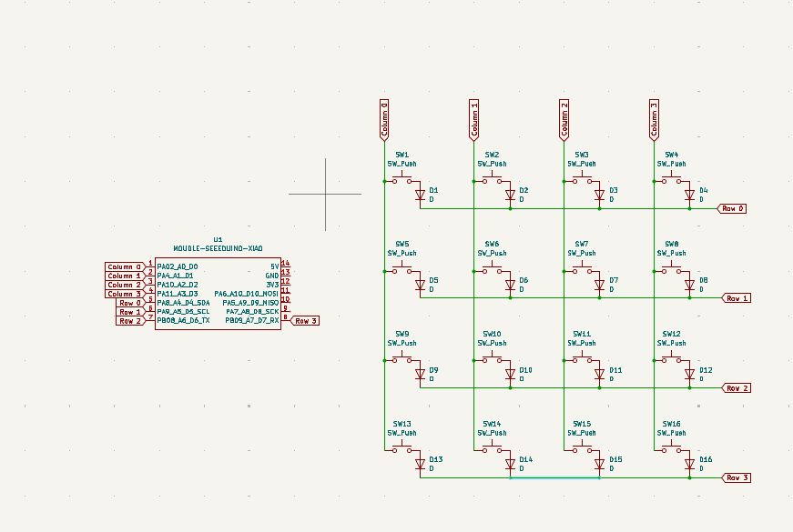
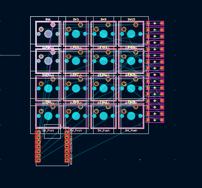
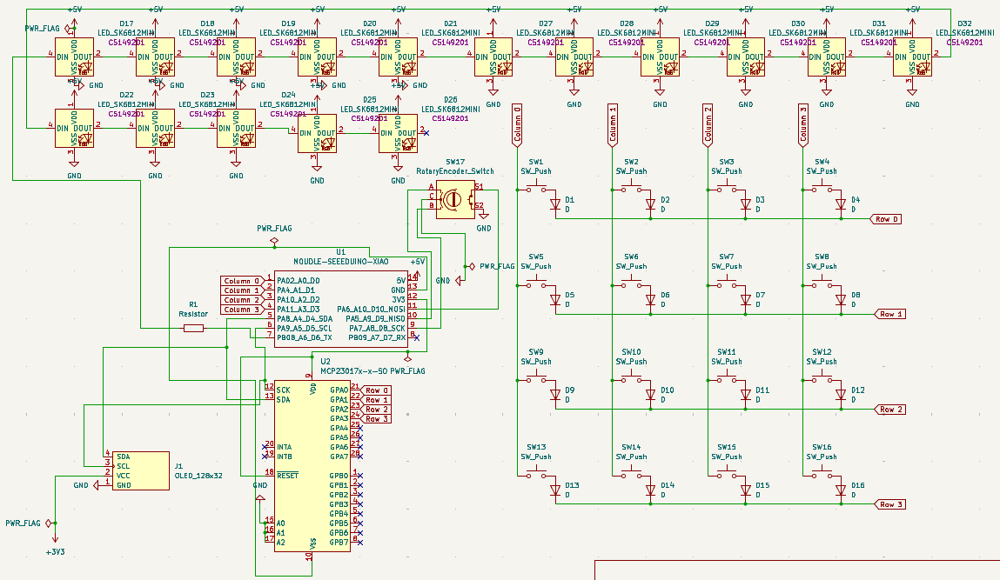

# November 1: Designed the Schematics layout

Worked on creating a matrix schematic for my macropad on Kicad and succesfuly created the schematic
and the connections.

**Total time spent: 2 hours**

# November 2: Designed the PCB layout

Worked on creating a PCB for my macropad on Kicad and added a rotary encoder components. A big time crunch today was making sure that my 
3dshapes paths were correct. This is my first time working on schematics and with the tutorial i'm watching of ScottoKeebs I ran into issues with pulling few 
3d models but after a few hours of troubleshooting I got it!

**Total time spent: 3 hours**

# November 3: Improve the schematics and added components

I realized yesterday(Nov 2) that I don't want to stick to just switches and rotary encoder. I want to add more features like led backlights to represent the 
command layer, or just for customization. I also wanted to add the oled display to display things features such as command layer, function choosen, or etc(the
full ideas for oled are still jogging through my mind for me to chase, lol). So I ended up watching a few videos, ton of google searches, and some questions for gemini
ro figure out how voltage works for these additional components, expanding pins available, making sure the electrical properties are working correctly, 
and that the schematics is also simplified. In the end I added all my components and simplified the schematic to the best of my current ability. The components added 
include 16 mini e leds, I/O expansion, and a 128 by 32 pixel OLED display

**Total time spent: 2.5 hours**
